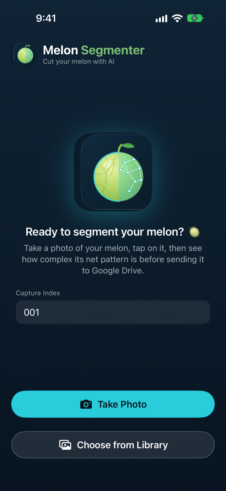
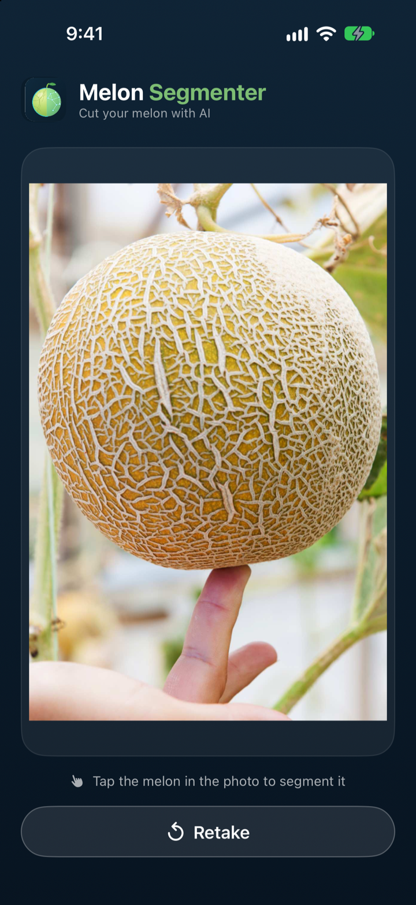
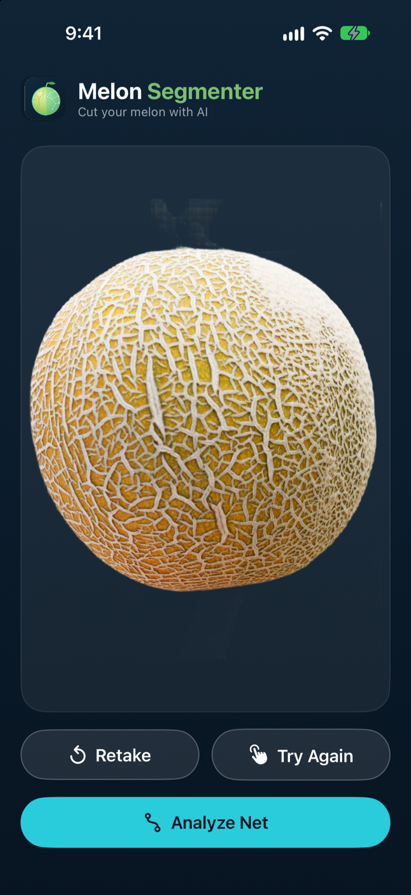
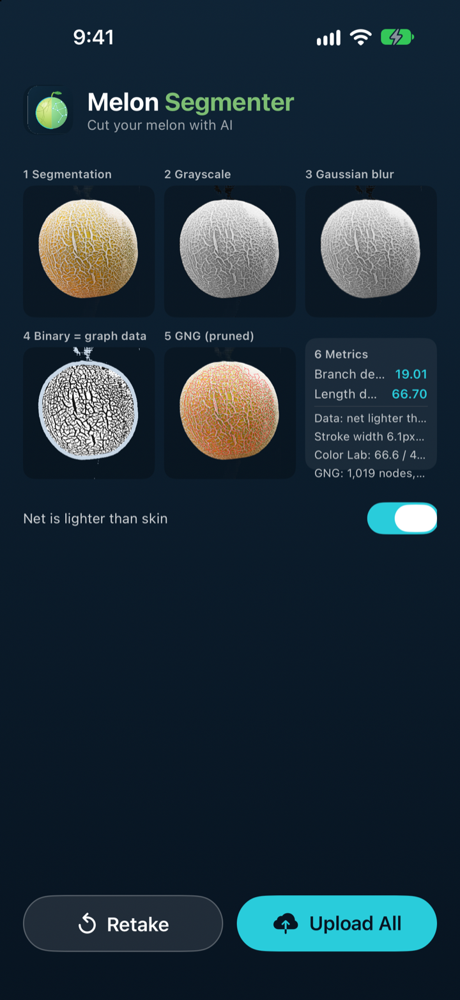

# Melon Segmenter 🍈

**Cut your melon with AI.** Melon Segmenter is an iOS app that isolates a melon from a photo with a single tap, then measures how dense the netting on its rind is.

Everything runs on the device: the segmentation uses [MobileSAM](https://github.com/ChaoningZhang/MobileSAM) through Core ML, and the net analysis uses a Swift port of the DBL-GNG (Distributed Batch Learning Growing Neural Gas) algorithm. Results can optionally be uploaded to your own Google Drive.

> The app **measures** the rind netting; it does not classify ripeness. The numbers are intended as input for studies of melon appearance, for example ripeness research.

## Screenshots

<table>
  <tr>
    <td align="center"><br><sub><b>1. Home</b><br>Enter a capture index, then take or choose a photo.</sub></td>
    <td align="center"><br><sub><b>2. Select the melon</b><br>Tap anywhere on the melon.</sub></td>
    <td align="center"><br><sub><b>3. Segmentation</b><br>MobileSAM cuts the melon out. Retry or continue.</sub></td>
    <td align="center"><br><sub><b>4. Net analysis</b><br>Six-panel breakdown with metrics.</sub></td>
  </tr>
</table>

The screenshots were taken in the iOS 27 Simulator with the sample photo [`docs/sample/demo_melon.jpg`](docs/sample/demo_melon.jpg). You can use the same photo to try the app yourself (see [Try it without a melon](#try-it-without-a-melon)).

## Features

- **Tap-to-segment.** Tap the melon and MobileSAM returns a clean, cropped cutout with a transparent background. If the mask is wrong, tap again.
- **Scale-independent net analysis.** The cutout is normalized to a fixed equivalent diameter, so photos taken at different distances or resolutions produce comparable numbers.
- **Visual debugging.** The result screen shows every processing stage: segmentation, grayscale, Gaussian blur, binary "net" mask, and the pruned GNG graph.
- **Reproducible results.** Sampling uses a seeded random number generator, so the same image always gives the same metrics.
- **Light or dark net.** A toggle switches the threshold polarity for melons whose net is lighter than the skin (typical for many netted melons) or darker.
- **Optional Google Drive upload.** The original photo, the cutout, the GNG overlay, a metrics JSON file, and a running CSV log are saved to your Drive.

## How it works

```
Photo ──► MobileSAM (tap prompt) ──► Cutout ──► Normalize ──► ROI ──► Blur + threshold ──► GNG ──► Metrics
```

1. **Segmentation.** The photo (longest side capped at 2048 px) is encoded once by the MobileSAM image encoder. Your tap is the prompt for the mask decoder. The mask is applied to the photo and the result is cropped to the melon's bounding box. Tapping again on the same photo reuses the cached image encoding.
2. **Scale normalization.** The cutout is resized so that its equivalent circular diameter is about 700 px (upscaling is capped at 4×).
3. **Region of interest (ROI).** The mask is eroded by 4 % of the diameter, using a two-pass chamfer distance transform, so that the mask boundary stays out of the measurement.
4. **Net detection.** A small masked Gaussian blur (σ = 1 px) removes noise. Each pixel is then compared against a much larger local average (σ = 2 % of the diameter); pixels that differ by more than a fixed offset are marked as net ("data") pixels.
5. **Growing Neural Gas.** Up to 6,000 net pixels are sampled and used to train a DBL-GNG network (at most 1,200 nodes). Triangle edges are then pruned, which leaves a skeleton-like graph of the net.
6. **Metrics.** The graph and the masks are turned into the numbers below.

| Metric | Meaning |
| --- | --- |
| **Branch density** | Graph nodes with three or more connections, per 10,000 px² of ROI. |
| **Length density** | Total length of the pruned graph edges (px), per 1,000 px² of ROI. |
| **Data fraction** | Share of the ROI that was classified as net. |
| **Stroke width** | Estimated average net thickness in px (net area ÷ total graph length). |
| **Equivalent diameter** | The diameter (px) the cutout was normalized to. |
| **Mean colour (CIE Lab)** | Average L\*, a\*, b\* colour over the ROI. |

The app also reports the GNG node count and the number of pruned edges.

> **Comparing results.** Only compare metrics that were produced with the same polarity setting ("Net is lighter than skin" on or off). The polarity is stored with every upload, so you can filter on it later.

## Requirements

| | |
| --- | --- |
| **Xcode** | 27 or later. The project file format (`objectVersion = 90`) was written by Xcode 27. |
| **iOS** | 17.0 or later (iPhone and iPad). |
| **Swift** | 5 language mode. |
| **Apple Developer account** | A free account is enough to run on your own device. |
| **Internet access** | Needed once, to download the Swift packages. Google Drive upload needs it at run time too. |

The Swift packages are fetched automatically by Xcode: [SamKit](https://github.com/john-rocky/SamKit) (MobileSAM runtime for Core ML) and [GoogleSignIn-iOS](https://github.com/google/GoogleSignIn-iOS). The MobileSAM Core ML models are already included in this repository (about 23 MB), so there is nothing else to download.

## Installation

### 1. Clone the repository

```bash
git clone https://github.com/yani-rl-ai/Melon_Segmenter.git
cd Melon_Segmenter
```

### 2. Open the project

```bash
open Melon_Segmenter.xcodeproj
```

Wait until Xcode finishes resolving the Swift packages (you can follow the progress in the status bar at the top of the window).

### 3. Set up code signing

1. Select the **Melon_Segmenter** project in the Project navigator, then the **Melon_Segmenter** target.
2. Open the **Signing & Capabilities** tab.
3. Choose your **Team**.
4. Change the **Bundle Identifier** from `com.mohamadyani.MelonSegmenter` to something unique to you, for example `com.yourname.MelonSegmenter`. Apple requires bundle identifiers to be unique, so the original one will not work with your team.

> If you also want Google Drive upload, use this same new bundle identifier in step 2 of [Setting up Google Drive upload](#setting-up-google-drive-upload-optional).

### 4. Run the app

1. Choose an iPhone or iPad simulator, or your own device, in the run destination menu.
2. Press **⌘R**.

The first launch of the segmentation step may take a little longer while Core ML prepares the models.

On a physical device, trust your developer certificate if iOS asks for it (**Settings ▸ General ▸ VPN & Device Management**).

### Try it without a melon

The Simulator has no camera, so **Take Photo** is only available on a physical device. In the Simulator, use **Choose from Library** instead. To add the included demo image to the Simulator's Photos library, run this while a simulator is booted:

```bash
xcrun simctl addmedia booted docs/sample/demo_melon.jpg
```

You can also drag any image file onto the Simulator window.

## Usage

1. **(Optional) Enter a Capture Index** on the home screen, for example `001`. It is used in the uploaded file names and in the CSV log, and it is remembered between launches. If the field is empty, a timestamp-based name is used.
2. **Take a photo** or **choose one from your library.** For the best results:
   - fill most of the frame with the melon,
   - use even, diffuse light and avoid glare on the rind,
   - use a plain background that contrasts with the melon,
   - keep the net in sharp focus.
3. **Tap the melon once.** MobileSAM creates the cutout. If the mask is not right, press **Try Again** and tap a different spot, or press **Retake**.
4. Press **Analyze Net.** Check the six panels. If the binary mask (panel 4) highlights the skin instead of the net, switch **Net is lighter than skin** on or off; the analysis re-runs immediately and the setting is remembered.
5. Press **Upload All** to send the results to Google Drive (optional, see below), or **Retake** to start over.

## Running the tests

The unit tests check the net analyzer against synthetic fixtures whose branch and length values are known independently: a grid-patterned disk, a plain disk (no net should be detected), and a reproducibility check (repeated runs must give identical metrics).

In Xcode, press **⌘U**. From the command line:

```bash
xcodebuild test \
  -project Melon_Segmenter.xcodeproj \
  -scheme Melon_Segmenter \
  -destination 'platform=iOS Simulator,name=<your simulator name>'
```

## Setting up Google Drive upload (optional)

The segmentation and analysis work without any Google account. Upload needs your own Google Cloud OAuth client, because the client ID in `Info.plist` is tied to the original author's Google Cloud project and bundle identifier.

1. Open the [Google Cloud Console](https://console.cloud.google.com/) and create a project (or pick an existing one).
2. Enable the **Google Drive API** for that project.
3. Configure the **OAuth consent screen**. While the app is in *Testing* status, add your own Google account under **Test users**. Without this step, Google signs you in without granting Drive access, and the app shows an error about the Drive scope.
4. Create an **OAuth client ID** of type **iOS**, and enter your bundle identifier from the installation steps.
5. In [`Melon_Segmenter/Info.plist`](Melon_Segmenter/Info.plist), replace both values with your own:
   - `GIDClientID` → `<your-client-id>.apps.googleusercontent.com`
   - the entry under `CFBundleURLTypes` → `com.googleusercontent.apps.<your-client-id>` (the reversed client ID)
6. Run the app again, finish an analysis, and press **Upload All**. Sign in when prompted.

The app only requests the `drive.file` scope, which limits it to files that the app itself creates. Uploads are organized like this:

```
My Drive/
└── Melon Segmenter/
    ├── density_log.csv            one row appended per upload
    └── 26_10_2026/                dd_MM_yyyy
        ├── melon-001-original.png
        ├── melon-001-segmented.png
        ├── melon-001-gng.png
        └── melon-001-metrics.json
```

## Project structure

```
Melon_Segmenter/
├── Melon_Segmenter.xcodeproj
├── Melon_Segmenter/                    App source
│   ├── MyApp.swift                     App entry point, Google Sign-In URL handling
│   ├── ContentView.swift               Main flow: home → segment → analyze → upload
│   ├── SegmentationView.swift          Tap-to-segment screen
│   ├── GNGResultView.swift             Six-panel analysis screen
│   ├── CameraCaptureView.swift         Camera wrapper (UIImagePickerController)
│   ├── MelonSegmenter.swift            MobileSAM session (SamKit) as an actor
│   ├── NetDensityAnalyzer.swift        Normalization, ROI, threshold, metrics
│   ├── GrowingNeuralGas.swift          DBL-GNG implementation
│   ├── KDTree.swift                    Nearest-neighbour search used by the GNG
│   ├── SeededRandomNumberGenerator.swift  Reproducible sampling
│   ├── GoogleDriveUploader.swift       Sign-in and Drive v3 REST upload
│   ├── MelonTheme.swift                Colours and button styles
│   ├── mobile_sam_encoder.mlpackage    MobileSAM image encoder (Core ML)
│   ├── mobile_sam_decoder.mlpackage    MobileSAM mask decoder (Core ML)
│   └── mobile_sam_prompt_encoder_weights.json
├── MelonSegmenterTests/                Unit tests for the net analyzer
├── docs/
│   ├── images/                         README screenshots
│   └── sample/demo_melon.jpg           Sample melon photo
└── LICENSE
```

## Troubleshooting

| Problem | What to try |
| --- | --- |
| **"Signing for Melon_Segmenter requires a development team"** or a bundle-identifier error | Select your team and use a unique bundle identifier (see [step 3](#3-set-up-code-signing)). |
| Xcode cannot resolve packages | Check your internet connection, then choose **File ▸ Packages ▸ Reset Package Caches** and **Resolve Package Versions**. |
| You want to use **Take Photo** in the Simulator | The Simulator has no camera, so use **Choose from Library** instead (see [Try it without a melon](#try-it-without-a-melon)). |
| *"Segmentation failed"* | Make sure the two `.mlpackage` folders in `Melon_Segmenter/` are present and part of the app target. Tap directly on the melon, not on the background. |
| *"Not enough net texture was detected to analyze."* | Toggle **Net is lighter than skin**, retake the photo with the melon larger in the frame and in sharper focus, or check that the cutout covers the melon. |
| *"Google didn't grant Drive access for this account."* | Enable the Drive API and add your account as a test user on the OAuth consent screen (see [Google Drive setup](#setting-up-google-drive-upload-optional)). |
| Google Sign-In cannot return to the app | The URL scheme in `Info.plist` must be the reversed client ID that matches `GIDClientID`. |

## Known limitations

- The metrics have **not** been validated against ground-truth ripeness labels, and they depend on lighting, focus, and the polarity setting.
- The analysis works on a single flat 2-D cutout and normalizes it by its equivalent circular diameter. Net near the edge of the melon is foreshortened in the photo, which the metrics do not correct for.
- The numbers in the screenshots come from a single sample photo and are only an illustration.

## Acknowledgements

- [MobileSAM](https://github.com/ChaoningZhang/MobileSAM) — C. Zhang et al., *Faster Segment Anything: Towards Lightweight SAM for Mobile Applications* (Apache-2.0).
- [SamKit](https://github.com/john-rocky/SamKit) — Core ML runtime for SAM models on Apple platforms (Apache-2.0).
- [DBL-GNG](https://github.com/CornerSiow/DBL-GNG) — the reference implementation that the Swift GNG is ported from.
- [GoogleSignIn-iOS](https://github.com/google/GoogleSignIn-iOS) — Google sign-in (Apache-2.0).

## License

Released under the [MIT License](LICENSE). The bundled and downloaded third-party components keep their own licenses (see [Acknowledgements](#acknowledgements)).
